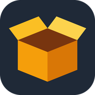

<p align="center"></p>

# Stash

A home inventory for one family, modeled on [Homebox](https://github.com/sysadminsmedia/homebox) and built around Claude. Items live in nested locations (House / Garage / Shelf 2) with labels, photos, receipts, manuals, purchase and warranty facts, custom fields, and an upkeep log. It runs on a Mac mini home server and is reached from phones and an iPad over a private tailnet.

The part worth reading is how the model is used: small, structured calls that each do one job, every answer checked by plain code before it touches the database, and a measured choice of model per job.

Flask, SQLite (WAL), waitress, plain HTML/CSS/JS. No build step, no framework on the front end.

## What it does

**Getting things in**
- **Snap to add.** Pick a photo on the new-item form and Claude fills the empty fields: name, brand, model, serial number read off the rating plate, a one-line description, and matching labels. It never overwrites what you typed.
- **Walk a room.** Upload up to 20 photos of a closet or shelf. Claude lists each distinct thing worth tracking, groups identical small items, and picks the photo that shows each one best. You untick, rename, and add.
- **Receipt reader.** Attach a receipt or warranty card (photo or PDF). Claude picks the line for this item, not the receipt total, and turns "3 year limited warranty" into an end date. A review page shows found values next to current ones; you tick what to save.
- **Stock photos.** Items saved without a photo get one in the background: the maker's product page first, then retailers, then an example from Wikimedia Commons with its license credit. They carry a Stock tag, your own photos always win, and the insurance report leaves them out.
- **CSV import and export**, idempotent by item id, plus a zip export with the database, the CSV, and every file.

**Keeping it useful**
- **Insurance report.** A printable inventory by location with photos, serial numbers, what you paid, and what it would cost to replace today. Save as PDF from the print dialog.
- **Replacement cost.** Claude searches for today's price of the same item new, or the closest current equivalent, and says which.
- **Product recall check.** A weekly job matches items against the US Consumer Product Safety Commission recall list. Code picks candidates by brand and model; Claude judges each one ("this recall covers DWD110 and DWD112 drills, not the DCD771"). Hits show on the dashboard with what to do.
- **Manual finder.** Finds the owner's manual and attaches the PDF, or saves the link when the PDF cannot be fetched.
- **eBay prep.** Move items to an eBay list and Claude gathers comparable listings, suggests a list price and a quick-sale price, and drafts an 80-character title, category, item specifics, description, and shipping weight. Tap to copy.
- **Bulk edit, QR labels, upkeep log, warranty alerts.**

## How Claude is used

All model calls live in [`ai.py`](ai.py). Each one sends a short system prompt and a strict JSON schema (structured outputs), so the app gets typed fields back instead of prose to parse. Plain code then validates every value: dates are re-parsed, prices clamped, URLs limited to http(s), label names matched against labels that exist, photo indexes bounds-checked.

| Job | Model | Why |
|---|---|---|
| Identify an item from photos, read receipts, walk a room, judge recalls | Claude Opus | Vision and careful reading. A wrong serial number or a false recall alarm costs more than the call. |
| Replacement price, manual search, eBay research, stock photo search | Claude Haiku with web search | Measured on the same lookups: identical answers at about 5% of the cost (about $0.012 vs $0.22 a lookup) and 6x faster. |

That second row came from testing five configurations against the same item before choosing. The default Opus setup with an advanced search tool read about 39,000 input tokens of search results per lookup; Haiku with a basic search capped at two queries read about 13,000 and returned the same price.

Without an API key, or on a Python too old for the SDK, the Claude buttons hide and the rest of the app works.

## Security

It is a family app with no login, so the work went into keeping it reachable only by the family and keeping what it stores private:

- Binds to `127.0.0.1`; the tailnet reaches it through `tailscale serve`.
- Host allowlist (blocks DNS rebinding) and same-origin checks on every write (blocks cross-site form posts).
- Strict Content Security Policy, `X-Frame-Options: DENY`, `nosniff`, open-redirect guard on every `next` parameter.
- Photos are re-saved without EXIF, because phone photos carry the house's GPS position. iPhone HEIC files become JPEG.
- Every upload is parsed by Pillow before it is accepted. PDFs and documents are served as downloads, never rendered on the app's origin.
- Anything fetched from the web (manuals, stock photos) goes through one function that allows only http(s), resolves the host and refuses private addresses, and re-checks every redirect.
- Files are deleted only after the database change commits; a nightly sweep quarantines orphans for 30 days.
- Backups are local first (sqlite `.backup` plus 30 days of hardlinked photo snapshots), then a time-capped copy to iCloud, all owner-only.

## Run it

```bash
python3 -m venv venv && ./venv/bin/pip install -r requirements.txt
./venv/bin/python app.py          # waitress on http://127.0.0.1:5189
./venv/bin/python app.py --dev    # Flask dev server with debug
```

For the Claude features, put an Anthropic API key in `ANTHROPIC_API_KEY` or in the macOS login Keychain:

```bash
security add-generic-password -a "$USER" -s stash-anthropic -w 'YOUR_KEY' -U
```

Settings come from the environment: `STASH_PORT`, `STASH_HOST`, `STASH_DB`, `STASH_UPLOADS`, `STASH_SECRET`, `STASH_ALLOWED_HOSTS` (comma-separated host names to accept besides localhost), `STASH_KEYCHAIN_SERVICES`. Example LaunchAgents for the app, the nightly backup, and the weekly recall check are in [`deploy/`](deploy).

Other jobs from the command line: `app.py --recalls` (sync the recall list and check items), `app.py --sweep` (orphan file sweep, run by `backup.sh`).

## Data model

`locations` (a self-referencing tree), `labels`, `items` (with a JSON column for custom fields and the replacement price), `item_labels`, `attachments` (photo, stock, receipt, manual, warranty, document), `maintenance`, `recalls` and `recall_checks` (a local copy of the CPSC list, kept because its text search is unreliable while date-range queries work), and `ebay` (cached research). New columns are added at startup when missing, so upgrades need no manual migration.

## Files

| File | What it holds |
|---|---|
| `app.py` | Routes, validation, uploads, report, bulk edit, walkthrough, stock photos, safe fetching |
| `ai.py` | Every Claude call, its prompt, and its schema |
| `recalls.py` | CPSC sync, candidate matching, cached verdicts |
| `backup.sh` | Nightly backup and orphan sweep |
| `templates/`, `static/` | Jinja templates, one stylesheet, one small script |
